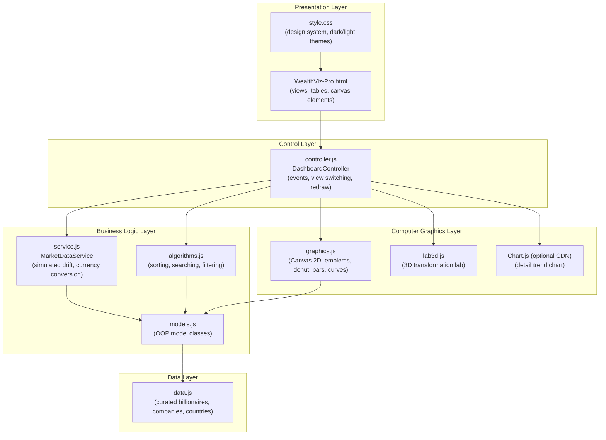
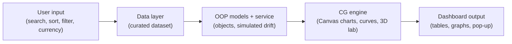
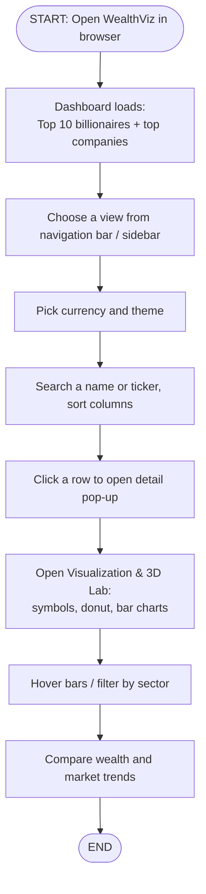

# WealthViz
The wealth of billionaires and the value of big companies change every day with the market. Platforms such as Forbes Real-Time Billionaires, the Bloomberg Billionaires Index, Yahoo Finance, Google Finance, TradingView and Macrotrends track these figures, but the data is spread across many websites and is mostly shown as plain tables

# WealthViz Pro — Financial Wealth & Market Dashboard

A web-based financial dashboard that shows the net worth of the top 100 billionaires, the market capitalisation of 15 global companies and wealth by country, with graphs and curves for market trends. Built as an **Object-Oriented Programming (OOP) and Computer Graphics (CG)** mini project using HTML5, CSS3 and JavaScript on the HTML5 Canvas.

> **Data note:** The dataset is a curated benchmark (reference: October 2024, based on public Forbes / Bloomberg estimates and SEC filings). "Live" values are **simulated** with a small random drift (about ±0.3% to ±0.6% per tick) for educational demonstration. This is not investment advice.

**Team:** Mukul Sudhir Khadse (27), Aditya Vinod Matre (39)
**Guide:** Prof. Smita Patil
**College:** K. K. Wagh Institute of Engineering Education and Research, Department of Computer Engineering

---

## Features

- **Dashboard overview:** summary cards (billionaires tracked, combined wealth, enterprises, countries) and Top 10 billionaires.
- **Top 100 Billionaires:** sortable table with simulated 24h change.
- **By Country:** country selector with national rank, plus a wealth-distribution **donut chart**.
- **Top Companies:** 15 global enterprises with price, market cap, CEO and sector.
- **Visualization & 3D Lab:** vector brand emblems, Bézier trend curves, market-cap bar visualizer with sector filters, and a 3D transformation lab.
- **Controls:** search by name or ticker, sortable columns, currency switch (USD, EUR, INR, GBP), dark / light theme, detail pop-up with trend chart.
- **No login required;** responsive layout.

---

## System Architecture

The code is split into layers so that data, logic, graphics and user interaction stay separate.



### Layer summary

| Layer | File(s) | Responsibility |
|---|---|---|
| Presentation | `WealthViz-Pro.html`, `style.css` | Page structure, views, theming, responsive layout |
| Control | `controller.js` | `DashboardController`: handles clicks, search, sort, currency, theme and redraws |
| Business logic | `service.js`, `algorithms.js`, `models.js` | `MarketDataService` (simulated drift, currency), sorting / searching / filtering, model classes |
| Data | `data.js` | Curated reference dataset |
| Computer graphics | `graphics.js`, `lab3d.js` | Canvas 2D charts, curves, emblems, 3D lab |

Scripts are loaded in architectural order: `data.js` → `models.js` → `service.js` → `algorithms.js` → `graphics.js` → `lab3d.js` → `controller.js`.

---

## Workflow

### Application workflow



1. The page loads and the dataset is converted into model objects.
2. `MarketDataService` applies a small random drift at regular intervals to simulate live changes.
3. `DashboardController` listens for user actions (view change, search, sort, currency, theme).
4. The controller asks the graphics layer to redraw tables and Canvas charts.

### User workflow (how to use the dashboard)



---

## Tech Stack

| Area | Technology |
|---|---|
| Markup | HTML5 |
| Styling | CSS3 (CSS variables, dark / light themes, responsive layout) |
| Language | JavaScript (ES6) with classes |
| Graphics | HTML5 Canvas 2D API (arcs, Bézier curves, gradients, compositing, animation) |
| Charts | Chart.js 4.4.1 via CDN (optional; offline Canvas fallback built in) |
| Editor | Visual Studio Code |
| Browser | Chrome, Edge or Firefox |
| OS | Windows / Linux / macOS |

### OOP and CG concepts used

- **OOP:** classes and objects, encapsulation, abstraction, inheritance, polymorphism, Strategy pattern (brand emblems), separation into model, service and controller layers.
- **Computer Graphics:** 2D primitives, polar arcs (donut chart), quadratic Bézier smoothing, gradients, `destination-out` compositing (Apple logo bite), animation (pulsing end-points), hover coordinate scaling, 3D transformations.

---

## Project Structure

```
WealthViz/
├── WealthViz-Pro.html   # Main page (views, canvases, modal)
├── style.css            # Design system and themes
├── data.js              # Curated dataset
├── models.js            # OOP model classes
├── service.js           # MarketDataService
├── algorithms.js        # Sorting, searching, filtering
├── graphics.js          # Canvas 2D drawing
├── lab3d.js             # 3D transformation lab
├── controller.js        # DashboardController
└── README.md
```

---

## How to Run

1. Keep all files in the same folder.
2. Open `WealthViz-Pro.html` in a modern browser (double-click, or use the VS Code *Live Server* extension).
3. An internet connection is only needed for the optional Chart.js CDN; the Canvas graphics work offline.

---

## Testing

| Test | Expected result |
|---|---|
| Search "Musk" / "AAPL" | Elon Musk / Apple Inc. appears |
| Click Net Worth header | Rows sort by wealth |
| Select INR (₹) | All values shown in ₹ |
| Select "India" in By Country | Only Indian billionaires listed |
| Choose a sector filter | Only that sector's bars drawn |
| Click a table row | Detail pop-up with trend chart opens |
| Toggle Dark / Light | Theme switches |

---

## Future Scope

- Connect a real market API for true live data.
- Add historical price charts and more companies.
- Add more visualization options.

---

## Disclaimer

All corporate brand names, tickers and vector emblem symbols (Apple, Microsoft, NVIDIA, Google, Amazon, Meta, Tesla, Berkshire, TSMC, Eli Lilly, Visa, JPMorgan, ExxonMobil, Reliance, Oracle) are trademarks of their respective owners and are used here solely for educational / data visualization demonstration.
